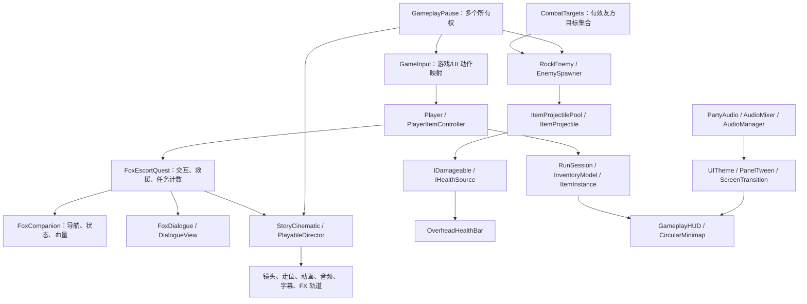

# 森林派对升级：架构与审查

## 组成

## 生命周期和兼容性

背包、耐久和玩家状态继续由 `RunSession` 持有，场景视图不会重复发放道具。新增 `IntroSeen` 仅保存在当前会话。第一关场景每次重建狐狸任务、刷怪器和导航；第二、三关继续使用原物品定义判断摆放。旧第一关目标组件从场景解绑，原脚本和狐狸物品资产保留。

`FoxCompanion` 区分未找到、对话、跟随、等待、到达和倒地。只有健康的跟随/等待狐狸进入 `CombatTargets` 的有效候选。敌人逐帧选择感知范围内最近候选，接触、普通弹体、爆炸继续经过同一受伤接口和阵营过滤。倒地立即失去目标资格，救援回满并获得保护；到达去重。

`StoryCinematic` 取得独立暂停所有权，关闭导航、改用非缩放动画和 Timeline。结束/跳过通过一次性提交恢复搜索点或聚会状态，归还导航、相机、动画模式、HUD 和暂停所有权。离场取消回调，不把退出场景当作团聚完成。背包、对话、死亡、选关仍各自持有暂停，不能相互解除。

头顶血条监听 `IHealthSource.HealthChanged`，在共用 Canvas 中投影世界锚点。池化敌人禁用时注销事件并移除视图，复用时重建，不跨场景保留旧 UI。

地图由 HUD 独占一个正交相机和 RenderTexture；角色模型、道具和特效通过层过滤，符号在圆形 Mask 内绘制。地面落叶合并成每场景一个网格，飘叶分区限制粒子数量，无 Collider，不进入 NavMesh 烘焙。

音效在伤害被接受/护盾实际格挡后触发；爆炸仍以目标集合去重。空间音源固定最多 24 个复用，音乐双源交叉淡化。AudioMixer 分组控制音乐、声音与拟声；UI 声音忽略 AudioListener 暂停，战斗音源随游戏冻结。

## 仍适合后续优化的地方

| 优先级 | 位置/问题 | 影响与建议 |
|---|---|---|
| P1 | `KitchenObjectSO` 仍沿用厨房命名 | 已承载战斗和任务物品。下一轮可用迁移属性逐步改成通用 ItemDefinition，集中效果策略；本次保持旧 SO GUID 和关卡绑定。 |
| P1 | `StoryCinematic`、`FoxEscortQuest` 有场景单例 | 当前单玩家三关足够；更复杂任务应由场景上下文显式注入玩家/服务，减少查找与静态耦合。 |
| P1 | 狐狸/敌人每个 AI 独立寻路 | 三怪三狐狸规模较小；增加数量前应测量并集中调度寻路，避免频繁请求。不能以瞬移掩盖路径问题。 |
| P2 | `GameplayHUD` 仍在代码中构建部分视图 | 可调主题已抽取；策划频繁改背包布局时，建议拆成可编辑 HUD/背包/死亡子预制体，保持事件绑定入口。 |
| P2 | `MinimapSymbols` 按三只狐狸和三只怪物预留标记 | 当前刷怪上限为三只且已缓存刷怪器；扩大规模时应改为按实体注册/回收标记，并同步容量。 |
| P2 | 两、三关旧目标仍轮询 | 后续用物品变化事件和可配置目标数组替代重复脚本，并让流程通过任务事件打开 UI。 |
| P2 | 音量使用 PlayerPrefs | 只承担简单偏好；后续接存档时应单独定义版本和失败回退，不能把运行时耐久写入共享 SO。 |
| P3 | 没有命名空间和 asmdef 边界 | 功能稳定后再按 Gameplay、Presentation、Editor、Tests 拆分，避免本轮迁移扩大序列化风险。 |
| 已知 | 两个原有嵌套预制体源文件缺失 | 登记在 `known-missing-assets.json`。本轮不伪造源文件，也不忽略新出现的引用错误。 |

## 验证证据

资源变更与原 GUID 对比见 `forest-asset-audit.json`；完整升级前快照为 `.organize-backup/forest-party-20261022.zip`。静态审计、自动化测试、Windows 构建和原生 Game View 检查分别记录，最终实际结果见《森林派对验证结果》，不把静态检查当作玩法运行通过。
