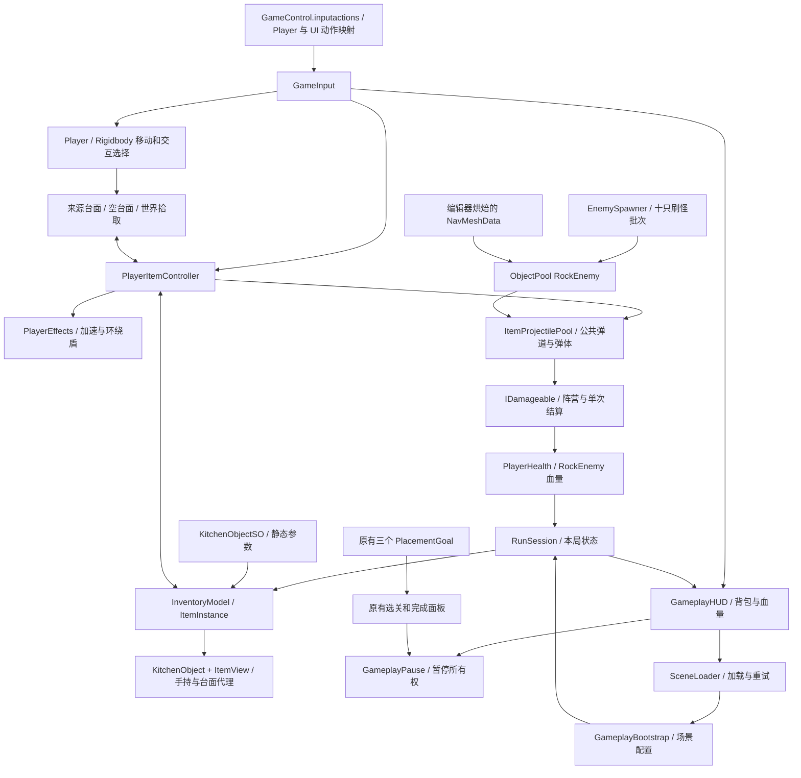

# 背包与战斗系统架构及审查

> 历史阶段记录。当前狐狸 NPC、Timeline、UI、音频与目标选择架构见 [森林派对架构与审查](森林派对架构与审查.md)。

更新：2026-10-20。沿用 Unity 2022.3.62f3c1、URP 14.0.12 和 Input System 1.14.2；未升级依赖或引入通用框架。资源分类、GUID 保留策略和旧类型名称映射见 [资源整理审查报告](项目架构与代码审查报告.md)。操作和全部调参入口见 [操作说明](背包与战斗操作说明.md)。

## 运行结构

## 数据、所有权与生命周期

`KitchenObjectSO` 只保存共享的模型、图标、效果类型和 Inspector 参数。`ItemInstance` 保存唯一 ID、定义和单件耐久；`InventoryModel` 保存所有物品及手持标识。装备不从列表中另复制物品，收起只清除手持标识。使用成功才扣耐久，投掷成功才移除整件。

`PlayerItemController` 将装备实例映射为手持视觉代理。`ItemView` 关闭代理的世界碰撞和拾取逻辑；放到台面时恢复原来启用的碰撞，并让台面拥有同一个实例。收取台面物品时先加入背包，再清理台面引用和旧代理。来源台面直接创建实例进入背包，一次性来源只在成功后失效。

`RunSession` 是本局内存状态，不是场景 GameObject，也不是磁盘存档。跨关保留库存、血量、护盾、加速和保护时间；每个新场景重新创建玩家组件及 HUD，并绑定现有会话。新局和死亡重试才重新发放物资，返回菜单结束会话。`PlayerEffects` 每帧驱动会话计时，暂停或加载时跳过，因此不依赖跨场景常驻玩家。

`GameplayPause` 按所有者记录暂停原因；背包、死亡和原有选关/完成面板分别持有暂停权限。只有所有原因释放后才恢复时间。`GameInput` 保留 UI 动作映射，暂停时关闭 Player 映射；移动、拾取、攻击和伤害入口还有状态检查。点击可交互 UI 时不会同时触发道具攻击。

## 战斗、导航和池

`Ballistics` 为玩家使用白菜、玩家右键投掷及怪物投掷计算共同的重力弹道；水平落点限制在物品范围内。普通弹体直接伤害，白菜在碰撞或引信到期时爆炸。`ItemProjectile` 每次租用重置速度、计时、发射者和已结算集合；爆炸按 `IDamageable` 去重，多个碰撞体不会重复扣血。

`DamageInfo` 携带阵营、伤害和来源。玩家攻击只影响敌方，敌方攻击只影响玩家。`PlayerHealth` 把伤害转交会话：先判断保护时间，再扣一层护盾或血量，死亡事件仅触发一次。怪物致死时先关闭攻击和碰撞，再回池。

`EnemySpawner` 独立维护累计成功生成数和当前存活集合，预热三个怪物。它在三个狐狸来源点附近按轮次寻找导航位置，要求胶囊空间未被玩家/怪物占用，并具有到玩家导航区域的完整路径；失败推迟尝试，不增加累计数。`RockEnemy` 用 NavMeshAgent 追踪，进入投掷范围且无遮挡时停下投掷，被遮挡时继续寻路。离场释放池并移除本场景导航实例。

第一关 NavMeshData 通过编辑器 `NavMeshBuilder.BuildNavMeshData` 烘焙。来源采用静态环境的物理碰撞，排除玩家、动态物品、弹体、UI 和触发器。玩家在树间可挤入的狭窄区域，未必能容纳半径 0.65 米的怪物；无合法连通位置时按规则等待，未添加穿墙或强行出生兜底。

正式敌人资产在 `Prefabs/Enemies`、`Art/Models/Enemies`、`Art/Animations/Enemies`、`Art/Materials/Enemies` 和 `Art/Textures/Enemies`。实际玩家视觉层级、网格、Animator Controller 和动画片段独立复制，复制岩石材质及纹理后赋给怪物；玩家和第三方原资产不修改。旧 `Prototypes/Combat` 保留，不接入新战斗规则。

## 场景与兼容

三关各有一个 `GameplaySystems` 根对象，显式配置 Catalog、玩家和现有场景 Canvas；第一关额外绑定刷怪器、三个狐狸锚点和导航。HUD 通过预制体实例化在注册 Canvas 下，所有新图形使用 UI 层并绑定该场景相机，随场景释放。

原有狐狸、食材和最终物品目标继续按 SO 定义判定。怪物清理不是原有通关条件；可继续完成狐狸摆放并进入下一关。旧资源 GUID 与原场景引用保留，新白菜单独新增定义与可拾取预制体。狐狸和蝴蝶图标由 Unity 对各自模型渲染缩略图得到。

## 审查发现与优化顺序

| 优先级 | 位置 / 现状 | 影响及建议 |
|---|---|---|
| P1，原有 | `ClearCounter.prefab`、`butterfly 1.prefab` 的两项嵌套来源缺失 | 见 `known-missing-assets.json`；需从原资产或历史恢复，不能用新增战斗资源掩盖 |
| P2 | `SceneLoader`、`GameplayHUD`、`BasePanel` 仍共同负责部分流程 | 当前已统一暂停并清理场景状态；下一阶段抽出小型流程控制器，让 UI 只发起重试/选关意图 |
| P2 | 三个 `PlacementGoal` 仍每帧轮询台面并直接创建面板 | 用台面物品变化事件与关卡目标 SO 替代重复逻辑；保持现有 SO 判断规则，分步迁移 |
| P2 | `AudioManager` 仍只保存内存音量 | 音频应用和落盘未扩建；后续接 AudioMixer 或显式音源注册，增加独立验证 |
| P3 | `KitchenObjectSO` 混合全部道具效果参数，厨房名称覆盖狐狸等任务物品 | 目前规模小、Inspector 易调；新增更多效果后，再迁移为统一 ItemDefinition 和分效果配置，需明确序列化迁移 |
| P3 | `GameplayHUD` 通过代码创建布局，库存变化时重建格子 | 初版库存较小；大容量时按 ID 增量更新并复用格子，配合可视区虚拟化，先测量再改 |
| P3 | 爆炸特效仍短时 Instantiate/Destroy，弹体和怪物已池化 | 当前同时三只敌人；高频爆炸时用 Profiler 评估是否也需要池化 |
| P3 | 怪物采样出生点可能多次失败，密集树林压缩导航空间 | 关卡迭代时设置经验证的备选出生点，查看 NavMesh 并调整环境间距；不要放宽到障碍内出生 |
| P3 | `PlayerItemController.GetAimPoint` 按当前水平地面高度筛选落点 | 当前三关适用；加入高低地形后用专用 Ground 层和地形规则取代高度阈值 |
| P3 | 业务仍位于默认程序集和全局命名空间 | 当前未引入框架；领域稳定后再拆 Runtime、Editor、Tests asmdef，避免默认程序集引用限制 |

这次没有实现存档、怪物掉落物、装备栏分类、任务追踪重构或音频扩展。敌人“随机丢出道具”按攻击弹体实现，死亡回收不额外发放可拾取物。

实际通过的测试、引用检查、构建结果和画面检查范围集中记录于 [验证结果](验证结果.md)，不以静态检查代替运行验收。
