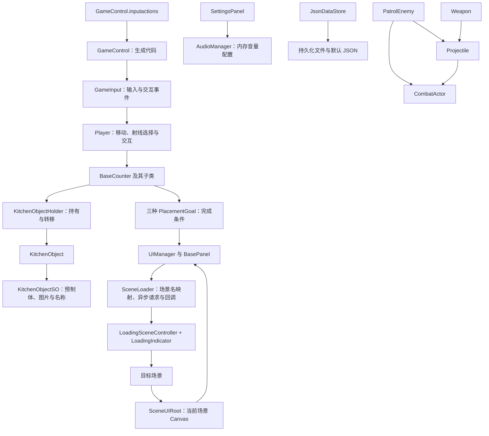

# 项目架构与代码审查报告

> 2026-10-22：当前完整架构与剩余优化项见 [森林派对架构与审查](森林派对架构与审查.md)，实际交付验证见 [森林派对验证结果](森林派对验证结果.md)。下文保留原整理阶段的审查证据。

> 2026-10-20 更新：本文件保留资源整理阶段的审查记录。当前已增加背包、单件耐久、血量、效果、导航战斗与对象池，玩家移动也已改为 Rigidbody.MovePosition。最新结构与未解决问题见 [背包与战斗系统架构](背包与战斗系统架构.md)，操作见 [背包与战斗操作说明](背包与战斗操作说明.md)，最终验证以 [验证结果](验证结果.md) 为准。

审查日期：2026-10-10。Unity：2022.3.62f3c1，URP：14.0.12，Input System：1.14.2。此次没有升级依赖，也没有重做玩法。

## 1. 本次结果

原项目共有 1,744 个资源文件，包含 38 个自有业务脚本和一个生成的输入封装。已迁移 1,671 个资源，保留原资源 GUID，将自有内容集中到 `_Project`，第三方包集中到 `ThirdParty`。17 个原本采用 GB18030/GBK 兼容编码的业务脚本已转换为 UTF-8，原始字节仍保存在本地备份中。

本次完成目录分类、主要类型与成员规范、明确缺陷修复和针对性验证。没有删除原型、示例、占位组件或没有直接场景引用的素材；它们的存在不等于完全没有用途。原型中已确认无效的 using、空生命周期方法、未使用计数器和旋转速度字段已清理。

详细证据见 [验证结果](验证结果.md)。资源映射见 `asset-migration.csv`，类型映射见 `type-renames.json`，接口变化见 [API 变更说明](API变更说明.md)。

## 2. 代码架构

这是以 Unity 组件和 Inspector 配置为中心的小型游戏工程。当前使用 Unity 默认程序集，没有自定义 asmdef；业务类基本位于全局命名空间。场景中的组件负责运行时逻辑，ScriptableObject 保存物品静态定义，UI 面板预制体通过 Resources 动态实例化。

### 输入与玩家

`GameControl.inputactions` 定义 Move 和 Interact，生成的 `GameControl` 提供 Input System 访问接口。`GameInput` 创建、启用和释放它，并向外发出交互事件。

`Player` 在 FixedUpdate 中按输入方向移动与旋转，在 Update 中进行前向射线选择台面。交互事件转交当前 `BaseCounter`，选中状态控制台面的高亮。`PlayerAnimator` 根据玩家移动状态更新 Animator 参数；`CameraMove` 和 `FoxLook` 提供简单的视觉跟随。

目前移动直接修改 Transform，没有完整的障碍物移动求解。此次保留现有移动方式，避免改变碰撞和手感；后续应依据实际场景需求选择 CharacterController 或 Rigidbody 移动，补充墙体与斜坡测试。

### 物品与交互

`KitchenObjectSO` 保存物品预制体、图片和名称；`KitchenObject` 引用定义。`KitchenObjectHolder` 保存挂点和当前物品，玩家与台面均可持有物品。

`ClearCounter` 在玩家和台面之间双向转移物品。`ContainerCounter` 根据配置生成物品并交给玩家。`OneShotContainerCounter` 保留原 SubmissionCounter 行为：首次成功给予物品后移除交互组件，但保留环境物体。`ButterflyCounter` 保留既有类型，共用 ContainerCounter 的实现。

转移现在是静态的成功/失败操作，不依赖调用者自身是否持有物品。它先验证双方与挂点、再设置目标、最后清空源；目标被占用或缺少挂点时不会丢失物品。重新设父节点保留世界缩放，避免不同缩放的台面和玩家改变物品尺寸。

### 关卡推进

`FoxPlacementGoal` 检查三个台面是否都有狐狸；`IngredientPlacementGoal` 检查三个台面的食材是否分别匹配；`FinalPlacementGoal` 检查最终台面的指定物品。完成后显示选关或完成面板，并停用自身。

这三个组件仍然每帧读取台面并直接依赖面板类型。此次只修复空配置误判和命名，没有将所有目标合并成配置驱动的通用框架。`GameManager` 仍是尚未接入流程的状态占位组件。

### UI 与场景生命周期

`BasePanel` 负责一次初始化、显示及淡出；`UIManager` 缓存当前场景的动态面板，通过 `Resources/UI/类型名` 定位预制体。每个正式场景的 Canvas 挂载 `SceneUIRoot`，显式注册自身。切换场景后旧 Canvas、面板及相机随场景释放；没有跨场景保留场景 Canvas。

`SceneLoader.Load` 把场景枚举映射为明确名称，先异步进入 `LoadScene`；`LoadingSceneController` 给加载画面一个更新帧，再启动目标场景的异步加载。目标场景 Awake 完成后，加载完成回调创建订单或菜单面板。加载中拒绝并发请求，完成后清理一次性回调。

首次主菜单保留约 5 秒延迟；完成返回主菜单时立即显示菜单。加载动画使用不受 timeScale 影响的等待，面板淡入淡出也使用 unscaledDeltaTime。

### 音频、存储与战斗原型

`AudioManager` 目前只保存两个音量值到内存，SettingsPanel 在打开时读取、关闭时写入。没有完整的 AudioMixer/AudioSource 应用链，也没有调用 JSON 落盘；因此设置值保留不代表音源音量已经改变。这项功能本次没有扩建。

`JsonDataStore` 是独立工具，目前没有被业务代码调用。默认使用 LitJson，也支持 JsonUtility；读取顺序现在是用户保存文件、默认文件、新对象。损坏文件会记录警告并回退。当前 StreamingAssets 读取仍使用 File API，本次验证的是 Windows；Android/WebGL 的 StreamingAssets 读取需要另行设计。

战斗原型独立放在 `Prototypes/Combat`。`CombatActor` 负责伤害与死亡，`PatrolEnemy` 负责巡逻与射击，`Weapon` 生成子弹，`Projectile` 根据原有标签规则判定命中。正式关卡没有直接挂载 PatrolEnemy；武器与子弹预制体仍被保留。没有为原型引入对象池、导航或新的敌人状态机。

## 3. 审查问题及处理

优先级：P1 为明显的运行/打包故障，P2 为生命周期与行为缺陷，P3 为扩展性与性能问题。

| 优先级 | 原问题 | 本次处理 |
|---|---|---|
| P1 | 没有选中台面时按交互键会调用空对象 | Player 交互入口检查选中目标；运行回归验证 |
| P1 | GameInput 没有禁用、退订和 Dispose | OnEnable/OnDisable/OnDestroy 成对管理；测试检查启停与订阅数量 |
| P1 | 空目标 SO 与空台面均为 null，可能立即判定关卡完成 | 必需配置缺失时报错并停用；运行测试验证未配置目标不完成 |
| P1 | 运行时代码导入 UnityEditor | 移除 CombatActor 中的无效依赖，Windows 开发构建验证 |
| P2 | 转移方法使用调用者字段，通用调用不安全 | 改为显式源与目标，失败不改变持有关系，保持世界尺寸 |
| P2 | UI 构造时全局查找 Canvas 并跨场景保留 | 由 SceneUIRoot 注册场景 Canvas，清理旧缓存 |
| P2 | 场景加载依赖枚举对应的构建索引 | 使用明确名称，LoadingScene 映射到实际 LoadScene |
| P2 | 订单面板在目标场景加载前创建 | 移到加载完成回调；回归验证三关订单显示 |
| P2 | 淡出回调可能重复执行，隐藏面板仍可接收输入 | 回调执行前清空，隐藏期间关闭 interactable/blocksRaycasts |
| P2 | 原型存在空巡逻点、空发射者、空音源/相机及重复死亡风险 | 增加边界处理；重复命中、死亡增加一次性保护 |
| P2 | 默认 JSON 抢先覆盖已保存的数据，损坏 JSON 无回退 | 用户文件优先，失败后回退；两种序列化方式均有测试 |
| P3 | CarMo 文件与 CameraMove 类不一致、名称拼写错误 | 同步文件/类型/引用与 UI 预制体名称 |
| P3 | 资源混在 Prefabs、Videos、_Assets，来源不明确 | 分类迁移、保留来源分组与名称映射 |
| P3 | 编码混合、空方法和重复来源逻辑 | 自有代码 UTF-8，清理空方法，共用物品生成逻辑 |

## 4. 保留的问题与后续优化顺序

### 第一阶段：恢复缺失原资源，完善设置行为

发现两个整理前就缺失的嵌套预制体来源：

| 保留资源 | 缺失 GUID |
|---|---|
| `_Project/Prefabs/Counters/ClearCounter.prefab` | `01a2813569e6d9e44b7ca8a18ddd3794` |
| `_Project/Prefabs/Items/butterfly 1.prefab` | `5328f4d2c0f5d1340b0ec29b6b629774` |

备份中的引用包含这两个 GUID，但原项目资源集合中没有对应资产。它们并非此次迁移导致；没有用其他模型猜测替换，也没有删除这些预制体。引用检查将它们明确列入已知问题。恢复原资源需要从原始素材或历史版本找回对应资产，并重新打开这两个预制体检查。

音频设置建议由一个音频服务统一管理音乐和音效通道，建立 AudioMixer 或显式注册 AudioSource 的应用关系；设置打开时初始化滑块、变化时应用、关闭时保存，启动时载入。先明确首次启动默认音量和静音规则，再增加持久化，避免延续当前两个值默认都是零的问题。

### 第二阶段：统一物品领域和关卡配置

KitchenObject 命名只适合厨房，但项目也将狐狸、蝴蝶当作可持有物品。后续可统一为 CarryableItem、ItemDefinition、ItemHolder，再将厨房配方作为扩展数据，减少概念误导。这属于领域接口变更，需要独立序列化迁移，故未混入本次整理。

增加物品持有变化事件，并把关卡条件写为配置资产：台面、所需物品和完成结果。一个目标评估组件在变化时检查条件，避免不断添加 Next2/Next3。完成结果交给独立流程控制器，由它决定显示面板或进入下一关。

### 第三阶段：合并 UI 重复内容，拆分职责

三个 OrderPanel 目前结构重复，RecipeUI 为空；可改为一个读取关卡订单配置的面板，保留相应美术布局。引入显式面板资源注册表，解除类名与 Resources 文件名的耦合，并在编辑器中验证注册完整性。

随着菜单、暂停、失败和存档恢复流程增加，再实现 GameManager 中尚未接入的状态。UI 只产生用户意图，流程控制器处理场景和状态；关卡目标只发完成事件。无需为现有规模引入大型依赖注入或事件总线框架。

### 第四阶段：依据测量优化性能

三个关卡序列化文件分别约 59 万、74 万、74 万行，说明场景数据量较大；行数不是帧率证据。应使用 Unity Profiler、Frame Debugger 和构建分析先定位 CPU、绘制、纹理和加载开销，再决定是否将重复环境物体改为预制体、启用合适的批处理/实例化，或拆分场景。

战斗原型中子弹、命中特效和死亡特效依赖 Instantiate/Destroy；在实际高频战斗出现后再引入对象池，明确归还时机和状态重置。PatrolEnemy 的旧式 OnGUI 血条可迁移为世界空间 UI，复杂移动可引入导航系统。此次没有用未经测量的性能假设改动玩法。

### 第五阶段：建立程序集与命名空间边界

当领域接口稳定后，再按 Runtime、Editor、Tests 拆分 asmdef，并为自有代码引入统一命名空间。注意默认程序集和自定义程序集之间的引用限制，以及类型迁移对序列化的影响。当前测试放在 Editor 默认程序集，可以引用现有运行时代码；不要只增加测试 asmdef 而不迁移运行时代码。

## 5. 维护与验证边界

本次通过自动化进入 Play Mode 验证业务行为，并通过 Windows 开发构建验证打包兼容性。批处理使用 `-nographics`，没有进行画面布局、视频颜色、光照质量或音量试听验收。JSON 测试不等于跨平台 StreamingAssets 支持；场景行为通过也不代表战斗原型已完成平衡或压力测试。

第三方源码与资源内容保持原样；它们的警告及原有缺失资产单独记录。项目没有自动提交或推送，原始文本和设置的本地备份位于 `.organize-backup/original-text.zip`，此目录已被 Git 忽略。
